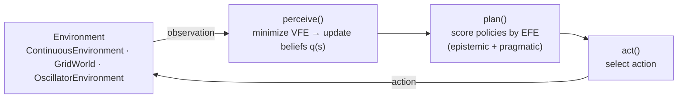

# active_torchference

PyTorch implementation of the Active Inference action-perception loop: variational and
expected free energy, belief updating, policy selection, and demo environments.
Agents act by minimizing free energy — no reward functions, no reinforcement learning.

## The loop



`ActiveInferenceAgent.step()` runs one pass of this loop. Beliefs live in `beliefs.py`,
free-energy terms in `free_energy.py`, policy evaluation in `policy.py`, and the
`orchestrators/` package runs, logs, plots and animates experiments.

## Install

```bash
git clone https://github.com/docxology/active_torchference.git
cd active_torchference
pip install -e .        # Python 3.11+, PyTorch 2.x
pytest                  # verify
```

## Quick start

```python
import torch
from active_torchference import Config, ActiveInferenceAgent
from active_torchference.environment import ContinuousEnvironment
from active_torchference.orchestrators import ExperimentRunner, Visualizer

config = Config(hidden_dim=8, obs_dim=2, action_dim=2, seed=42)
agent = ActiveInferenceAgent(config)
goal = torch.tensor([2.0, 2.0])
env = ContinuousEnvironment(config, goal_position=goal)

results = ExperimentRunner(agent, env).run(num_episodes=5, max_steps_per_episode=100)
Visualizer(save_dir="./results").plot_comprehensive_summary(agent.get_history(), goal=goal)
```

Runnable demos live in [`examples/`](examples/) (for example
`python3 -m examples.simple_navigation`); `make examples` runs them all and writes
artifacts under `output/<example_name>/`.

## Layout

| Path | Contents |
|---|---|
| [`active_torchference/`](active_torchference/) | Agent, beliefs, environments, free energy, policy, orchestrators |
| [`examples/`](examples/) | Navigation, grid-world exploration, epistemic/pragmatic balance, custom environments |
| [`tests/`](tests/) | pytest suite (unit and integration) |
| [`validation/`](validation/) | Explicit VFE and EFE validation scripts |
| [`docs/`](docs/) | [Quick start](docs/QUICKSTART.md), [architecture](docs/ARCHITECTURE.md), [API](docs/API.md), [belief and policy updates](docs/BELIEF_AND_POLICY_UPDATES.md) |

## Citation

See [`CITATION.cff`](CITATION.cff).

## License

Released under the [MIT License](LICENSE).
